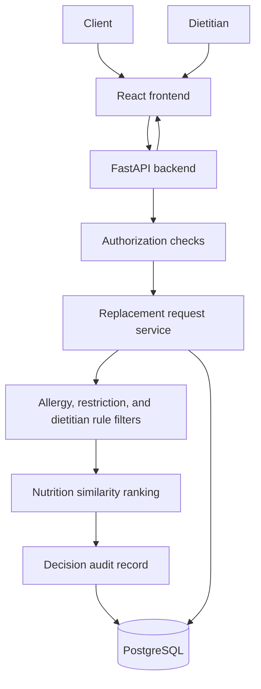

# Architecture

## Current Stage

This repository contains architecture documentation and project structure only. It does not yet contain a running backend, frontend, or database schema.

## Planned Monorepo Structure

```text
backend/
  app/                  Future FastAPI application package

frontend/
  src/                  Future React source
  public/               Future static assets

db/
  migrations/           Future PostgreSQL migrations

tests/
  backend/              Future backend tests
  frontend/             Future frontend tests
  integration/          Future cross-service tests

docs/
  product-scope.md
  development-flow.md
  architecture.md
  data-model.md
```

## Planned Components

- React frontend: dietitian and client user interface.
- FastAPI backend: API, domain services, validation, and authorization boundaries.
- PostgreSQL: relational persistence for users, clients, meal plans, foods, restrictions, rules, replacement requests, and audit records.
- Tests: backend, frontend, and integration coverage.

## Runtime Flowchart



## Replacement Request Flow

1. Client requests a replacement for a food in an approved meal.
2. Backend verifies the client can access that meal plan.
3. Backend loads allergies, restrictions, and dietitian-defined rules.
4. Backend loads candidate foods from the selected trusted food source.
5. Backend excludes candidates that violate constraints.
6. Backend ranks candidates using a transparent nutrition similarity method.
7. Backend stores the request, result metadata, and audit details.
8. Frontend displays ranked options and explanations.

## Explicitly Deferred Architecture

The following are intentionally excluded until the product has validated need:

- LLM orchestration
- Retrieval-augmented generation
- Vector databases
- Graph databases such as Neo4j
- Multi-agent systems

## Assumptions

- PostgreSQL is sufficient for the MVP data model.
- The first ranking approach can be deterministic and explainable.
- Nutrition data ingestion will be designed after a source is selected.
- Authorization requirements will influence table design and API boundaries.

## Unresolved Decisions

- Backend package and dependency management.
- Frontend build tool.
- API versioning strategy.
- Authentication provider.
- Hosting and deployment target.
- Observability stack.
