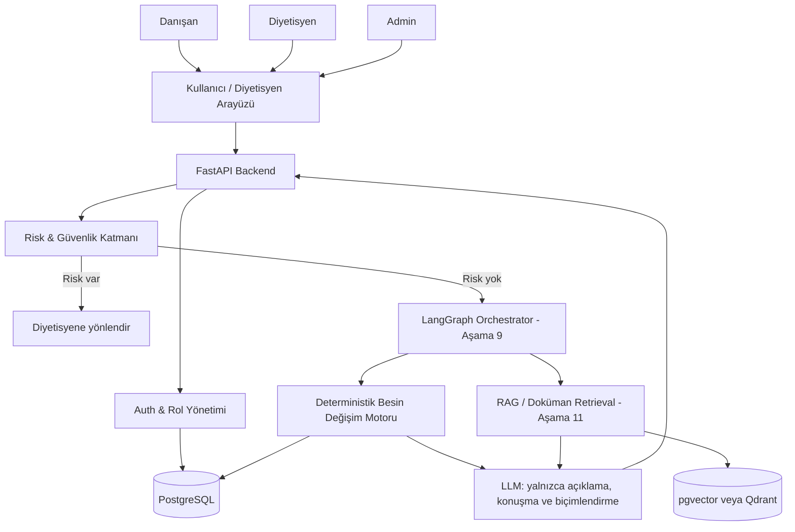

# Architecture

## Current Stage

The project is following the 13-stage roadmap recorded in NotebookLM. Stage 1 (scope, roles, and architecture boundaries) is approved and closed. A partial FastAPI/database health-check implementation exists, but Stage 2 is not considered complete until all Stage 2 acceptance criteria are implemented and verified.

No database domain models, LLM integration, LangGraph orchestration, RAG, vector database, or agent tools should be added yet.

## Architectural Invariants

1. PostgreSQL is the source of truth for structured data: users, roles, clients, plans, foods, portions, restrictions, rules, and audit records.
2. Nutrition and portion calculations belong exclusively to the deterministic substitution engine.
3. The LLM may explain, converse, and format text; it may not calculate nutrition values, diagnose, prescribe treatment, or approve plans.
4. Health-risk checks run before recommendation generation. Decisions use `BLOCK > REQUIRE_DIETITIAN_APPROVAL > ALLOW`; safety severity overrides the `client > plan > global` specificity order. Blocked cases are not applied, and approval-required cases are routed to a dietitian.
5. LangGraph is added only after CRUD, the deterministic substitution engine, the simple chat endpoint, and the agent-tool layer are complete.
6. pgvector or Qdrant is used only when document-based RAG is justified. It is not a food-data source or a substitute for PostgreSQL.
7. All authorization-sensitive and recommendation decisions must be auditable.

## Target Runtime Flow

The diagram shows the target architecture, not the current implementation. Components must be introduced only at their roadmap stage.

## Responsibility Boundaries

### FastAPI Backend

- Exposes versioned HTTP endpoints.
- Enforces validation, authorization, and error handling.
- Coordinates domain services without moving domain calculations into route handlers.

### Risk & Safety Layer

- Evaluates explicit, deterministic safety rules before recommendation generation.
- Stops unsafe or unsupported requests.
- Routes flagged cases to a dietitian and records the decision.

### Auth & Role Management

- Enforces the role boundaries in [roles.md](roles.md).
- Applies ownership and tenant/scope checks, not only role-name checks.
- Prevents clients, dietitians, and admins from crossing their authorized data boundaries.
- Denies Admin health-data access by default. Exceptional access must be justified, independently approved, least-privilege, time-bounded with UTC start/end values, automatically expired, and recorded in an immutable audit log.

### PostgreSQL

- Stores all structured operational and audit data.
- Remains the canonical source even if a vector store is introduced later.

### Deterministic Substitution Engine

- Filters candidates using allergies, restrictions, dietitian rules, and trusted nutrient data.
- Calculates portions, tolerance differences, and transparent rankings.
- Returns structured results and reasons that can be tested independently of an LLM.

### LangGraph Orchestrator

- Coordinates risk checks, tools, deterministic calculation, optional human approval, and response formatting.
- Does not contain hidden nutrition calculations.
- Is explicitly deferred until Stage 9.

### RAG / Vector Store

- Retrieves unstructured clinical or guidance documents with citations.
- Does not store canonical users, plans, foods, portions, or nutrient values.
- Is explicitly deferred until Stage 11 and requires a demonstrated document-retrieval need.

### LLM Layer

- Converts structured system output into understandable language.
- May summarize retrieved documents with references.
- Cannot override safety, authorization, deterministic calculations, or dietitian approval.

## Roadmap Gates

| Stage | Gate before moving forward |
|---|---|
| 1. Scope and roles | Scope, role boundaries, safety routing, and LLM/engine separation approved |
| 2. FastAPI skeleton | `/healthcheck`, Pydantic Settings, modular `api/v1` routers, security module, exception handlers, and tests verified |
| 3. PostgreSQL models | User, Role, and Client migrations applied successfully |
| 4. Client and plan CRUD | CRUD endpoints verified through automated tests and OpenAPI |
| 5. Food and nutrient model | Trusted-source seed/import and food search verified |
| 6. Deterministic engine | Calculation rules fully unit-tested; no LLM dependency |
| 7. Simple chat | Stateless response works and forbids LLM nutrition calculation |
| 8. Agent tools | LLM calls tools instead of calculating; risk tool routes correctly |
| 9. LangGraph | Risk → tool → deterministic engine → formatting flow and human pause verified |
| 10. Memory | Preferences and session state reload correctly with authorization |
| 11. RAG | Documents retrieve with correct references and measured quality |
| 12. Admin panel | Authorized management and review workflows verified |
| 13. Test/monitor/deploy | Calculation tests pass, coverage ≥85%, tracing and container deployment verified |

## Current Stage 1 Acceptance Checklist

- [x] Product scope and MVP workflow documented in [product-scope.md](product-scope.md).
- [x] Dietitian, Client, and Admin boundaries documented in [roles.md](roles.md).
- [x] LLM and deterministic-engine responsibilities separated.
- [x] Risky health cases route to a dietitian.
- [x] Target architecture and staged component gates documented.
- [x] Stage 1 role and authorization policy decisions resolved.
- [x] Rule specificity and safety precedence documented as an actionable decision table with examples.
- [x] Temporary Admin health-data access requirements documented.
- [x] Low-risk and high-risk substitution examples documented.
- [x] Product owner approved Stage 1.

## Explicitly Deferred Until Their Roadmap Stage

- Database domain models and Alembic migrations (Stage 3)
- Client and nutrition-plan CRUD (Stage 4)
- Food/nutrient ingestion (Stage 5)
- Deterministic substitution engine (Stage 6)
- LLM integration (Stage 7)
- Agent tools (Stage 8)
- LangGraph (Stage 9)
- Persistent conversation memory (Stage 10)
- RAG and vector databases (Stage 11)
- Admin panel (Stage 12)
