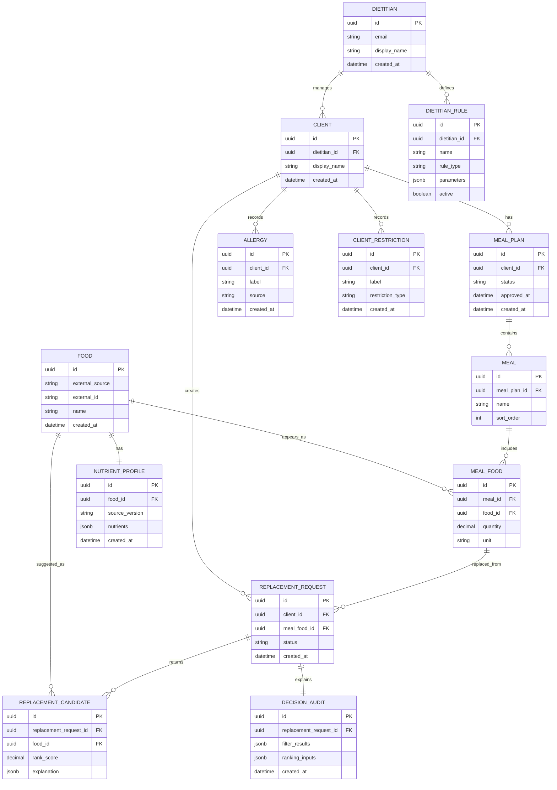

# Data Model

## Purpose

This document defines the conceptual MVP data model. It is not yet a database migration and does not include fake nutrition data or fake medical rules.

## Core Entities

- Dietitian: professional user who manages clients and meal plans.
- Client: person receiving nutrition support from a dietitian.
- Food: food item from a trusted nutrition data source.
- Nutrient Profile: nutrient values associated with a food.
- Meal Plan: dietitian-approved plan assigned to a client.
- Meal: meal within a meal plan.
- Meal Food: specific food and quantity included in a meal.
- Allergy: client-specific allergy record.
- Client Restriction: client-specific dietary restriction or preference.
- Dietitian Rule: configurable rule created by a dietitian.
- Replacement Request: client request to replace one meal food.
- Replacement Candidate: ranked alternative returned for a request.
- Decision Audit: stored explanation of filtering and ranking decisions.

## Mermaid ER Diagram

## Modeling Notes

- `Food` and `Nutrient Profile` depend on a trusted nutrition source selected later.
- `Dietitian Rule.parameters` is intentionally flexible at the conceptual stage, but should become more constrained when rule types are implemented.
- `Decision Audit` should capture enough information to explain why candidates were included, excluded, and ranked.
- Allergies and restrictions are stored as client-specific records. The scaffold does not define clinical interpretation rules.

## Unresolved Decisions

- Exact nutrient schema and units.
- Whether nutrient profiles are versioned per source update.
- Whether allergies and restrictions should reference controlled vocabularies.
- Whether meal-plan approval requires immutable snapshots.
- How replacement candidate explanations should be structured for both clients and dietitians.
