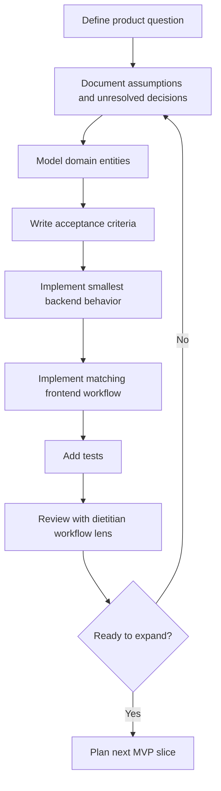

# Development Flow

## Goal

Use a small, reviewable development process that keeps product, clinical assumptions, data modeling, and implementation aligned.

## Development Principles

- Start with documented workflows before implementation.
- Keep clinical and nutrition assumptions explicit.
- Add tests with each implemented behavior.
- Prefer simple relational modeling before introducing specialized infrastructure.
- Keep dietitian review and auditability visible in the product design.

## Mermaid Development Flowchart

## Suggested First Implementation Slices

1. Repository tooling and health checks.
2. Database migration setup.
3. Dietitian, client, and meal-plan persistence.
4. Replacement request API.
5. Rule and restriction filtering service.
6. Ranking response contract.
7. Dietitian review workflow.

## Review Checklist

- Does this change preserve dietitian control?
- Are nutrition and clinical assumptions documented?
- Are generated recommendations explainable?
- Are rejected alternatives auditable?
- Are tests covering both allowed and blocked replacement paths?

## Unresolved Decisions

- Branching strategy.
- CI provider.
- Package managers for backend and frontend.
- Migration tool selection.
- Test framework details beyond likely FastAPI and React ecosystem defaults.
